# Olist Marketplace Intelligence: Operations Audit & Revenue Recovery

[](https://github.com/moazzem-hossain-majumder/olist-marketplace-intelligence/actions)
[](https://www.python.org/)
[](https://www.sqlite.org/)
[](excel/Olist_Ops_Command_Center.xlsx)
[](tests/)

An end-to-end data analytics and marketplace operations case study on the Olist Brazilian e-commerce dataset (~99.4k orders), built with **SQL, Python, and an automated Excel Operations Command Center**.

Simulated as a Senior Marketplace Operations & Growth engagement: five business-critical problems answered with production SQL, statistical modeling (logistic regression, empirical Bayes shrinkage), and an operational spreadsheet with live capacity models.

> 📑 **Executive Summary:** Read the 3-page decision memo for leadership: [reports/executive_memo.md](reports/executive_memo.md)  
> 📊 **Interactive Deliverable:** Download the dynamic [excel/Olist_Ops_Command_Center.xlsx](excel/Olist_Ops_Command_Center.xlsx) (or import into Google Sheets).

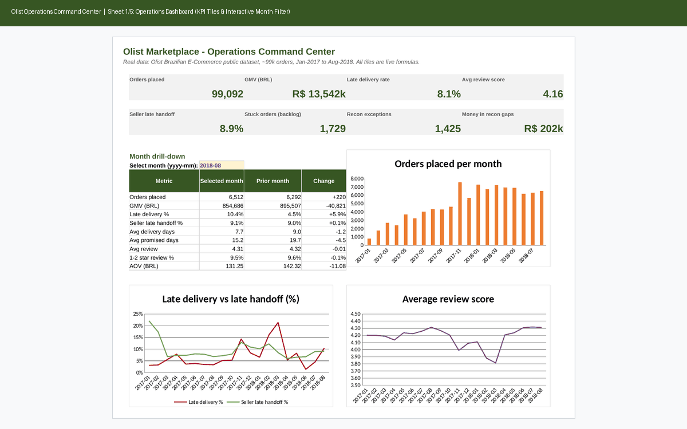
*Live preview of the 5-sheet Excel Command Center: dynamic KPI tiles, interactive `INDEX/MATCH` month filtering, 1,729-order priority worklist, dynamic capacity planning, empirical Bayes seller risk quadrants, and delivery SLA sensitivity calculator.*

---

## Contents
- [Pipeline Architecture](#pipeline-architecture)
- [Data](#data)
- [Core Business Problems](#core-business-problems)
- [Problem 1: Order-to-Cash Reconciliation](#problem-1-order-to-cash-reconciliation)
- [Problem 2: Stuck-Order Backlog](#problem-2-stuck-order-backlog)
- [Problem 3: Late Deliveries Root Cause](#problem-3-late-deliveries)
- [Problem 4: Seller Risk Score](#problem-4-seller-risk-score)
- [Problem 5: Retention and RFM](#problem-5-retention-and-rfm)
- [Excel Command Center](#excel-command-center)
- [Automated Testing & CI](#automated-testing--ci)
- [How to Run](#how-to-run)
- [Project Structure](#project-structure)
- [Limitations](#limitations)

---

## Pipeline Architecture

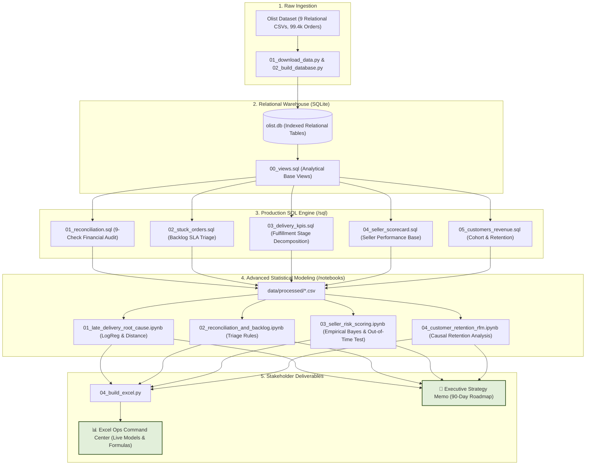

---

## Data

[Brazilian E-Commerce Public Dataset by Olist](https://github.com/olist/work-at-olist-data). This is real, anonymised data that Olist released publicly (it is also on Kaggle). It has 9 tables:

| Table | Rows | Description |
|---|---|---|
| orders | 99,441 | Order lifecycle timestamps and statuses |
| order_items | 112,650 | Product, seller, price, and freight per item |
| payments | 103,886 | Payment method, installments, and transaction value |
| reviews | 99,224 | Customer review scores (1-5) and feedback timestamps |
| customers | 99,441 | Customer unique IDs and geographic coordinates |
| sellers | 3,095 | Seller locations and unique IDs |
| products | 32,951 | Product dimensions, weights, and categories |
| geolocation | 1,000,163 | Zip-code latitude and longitude mappings |
| category_translation | 71 | Portuguese-to-English product category names |

Orders span Sep 2016 to Oct 2018. For monthly time series and KPI benchmarks, the window **Jan 2017 to Aug 2018** is used because boundary months are incomplete.

---

## Core Business Problems

1. **Reconciliation:** Do the orders, items, and payment ledgers match? Where they diverge, what is the exact revenue at stake, and what are the root causes?
2. **Stuck Orders:** 1,729 paid orders never reached a final status. How can a resource-constrained ops team triage and clear them?
3. **Late Deliveries:** What drives late delivery: seller preparation, carrier transit, distance, or unrealistic promised delivery dates?
4. **Seller Risk:** Which high-volume sellers require dedicated account-manager intervention, and how can we score risk without penalizing low-volume sellers?
5. **Customer Retention:** Does an initial late delivery destroy customer retention, or is that relationship confounded by order value and geography?

---

## Problem 1: Order-to-Cash Reconciliation

**Tools:** SQL (`sql/01_reconciliation.sql`), notebook `notebooks/02_reconciliation_and_backlog.ipynb`

An automated 9-point financial reconciliation engine auditing cross-system agreement (orders, line items, payments, reviews). Failing orders are captured in a granular exception register.

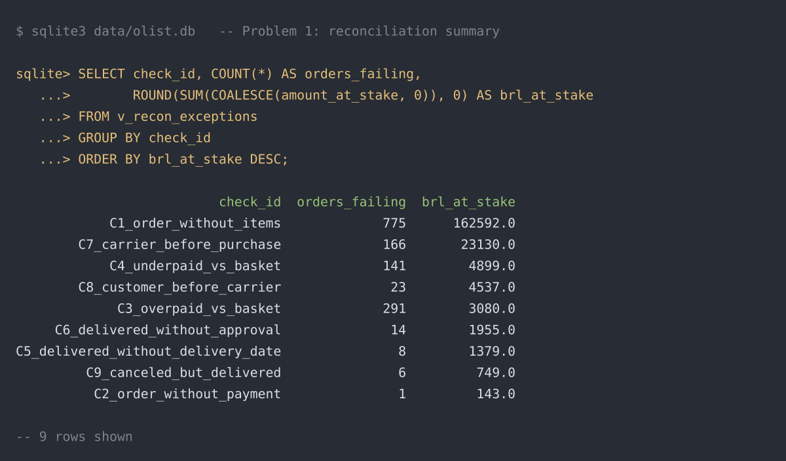

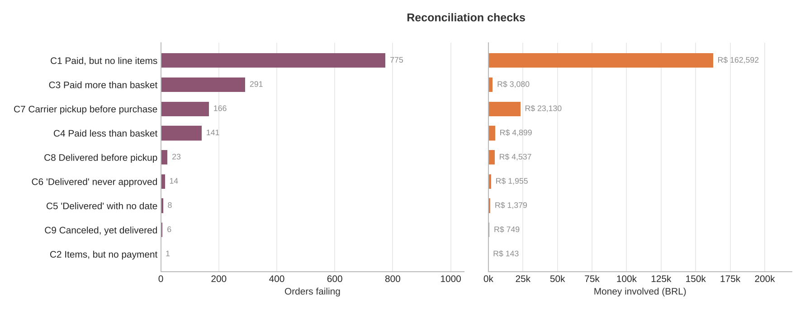

**Key Findings:**
- **1,425 total exceptions** representing **R$ 202k** in capital at risk.
- **80% of revenue leakage (R$ 162.6k across 775 orders)** originates from paid orders without line items. Almost all have status `unavailable` (line items stripped upon out-of-stock events while payments remained unrefunded).
- Overpayment rates scale monotonically with installment count (0.06% for 1 installment vs. 0.88% for $\ge 7$ installments), pinpointing installment interest unaccounted for in order line totals.
- 166 orders exhibit carrier pickup timestamps preceding purchase dates, isolated exclusively to post-April 2018 records (pointing to an uncoordinated tracking API migration).

| Overpayment vs Installments | Timestamp Anomaly Timeline |
|---|---|
| 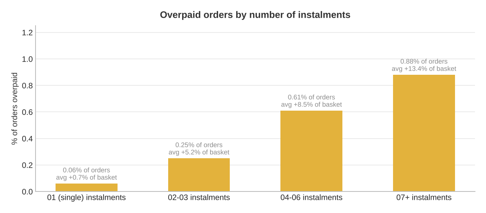 | 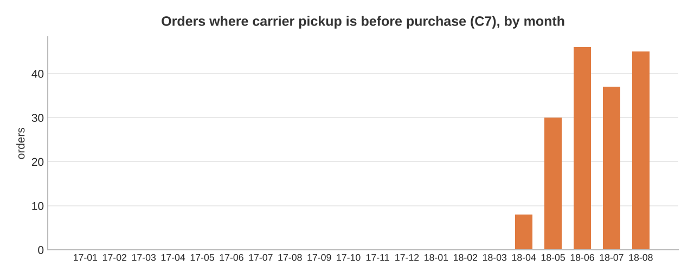 |

---

## Problem 2: Stuck-Order Backlog

**Tools:** SQL (`sql/02_stuck_orders.sql`), notebook `notebooks/02_reconciliation_and_backlog.ipynb`, Excel

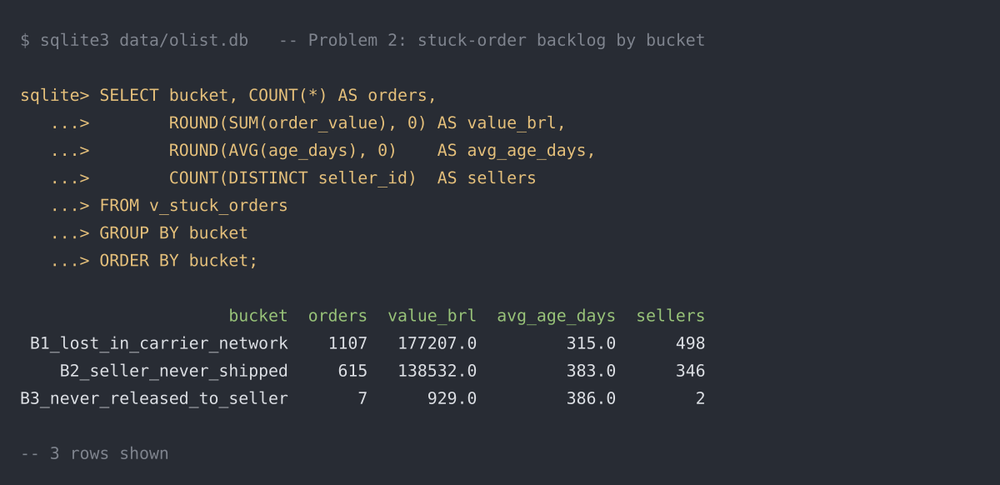

**Key Findings:**
- 1,729 orders (~R$ 317k) sit in unfulfilled limbo, all past their promised delivery dates.
- Inflow is persistent (35 to 165 new stuck orders/month), indicating chronic process leakage rather than an isolated incident.
- Orders are dispersed across 751 sellers; top 10 sellers represent only 13% of the backlog, ruling out seller-by-seller ad-hoc calling.

**Triage Strategy & Capacity Model:**
- **P1 ($\ge$ R$ 200):** Manual carrier trace (24% of orders, 61% of value).
- **P2 (R$ 80–200):** Batched seller/carrier inquiries (41% of orders).
- **P3 (< R$ 80):** Immediate programmatic refund (35% of orders, resolving 601 orders instantly).

With 4 operational agents (6 productive hours/day, 12 min/trace), the active backlog is cleared in **10 working days**.

| Stuck Orders per Month | Priority Breakdown |
|---|---|
| 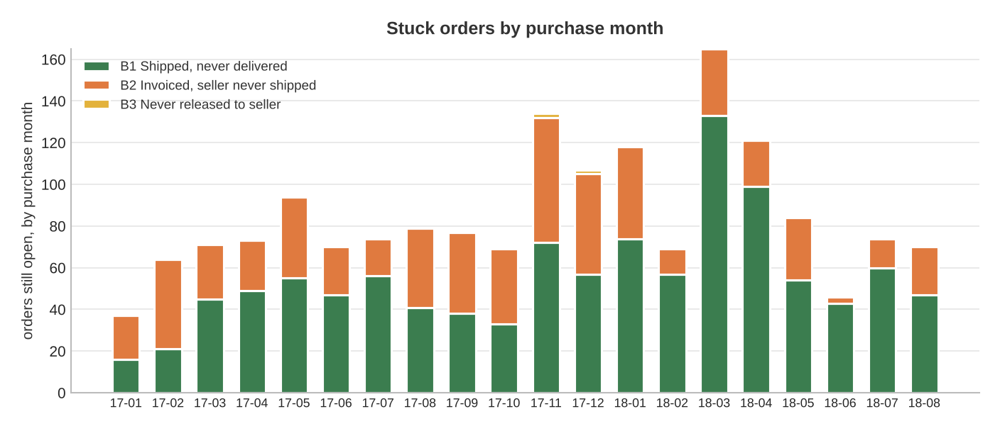 | 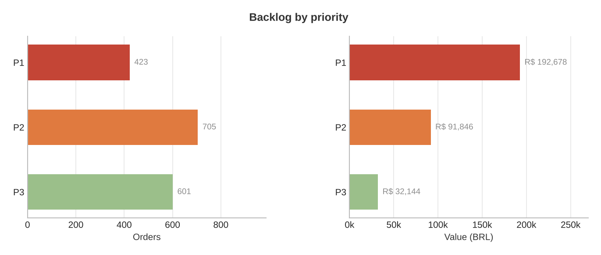 |

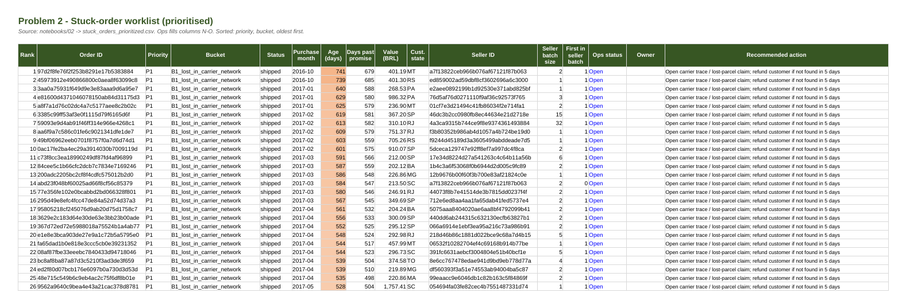

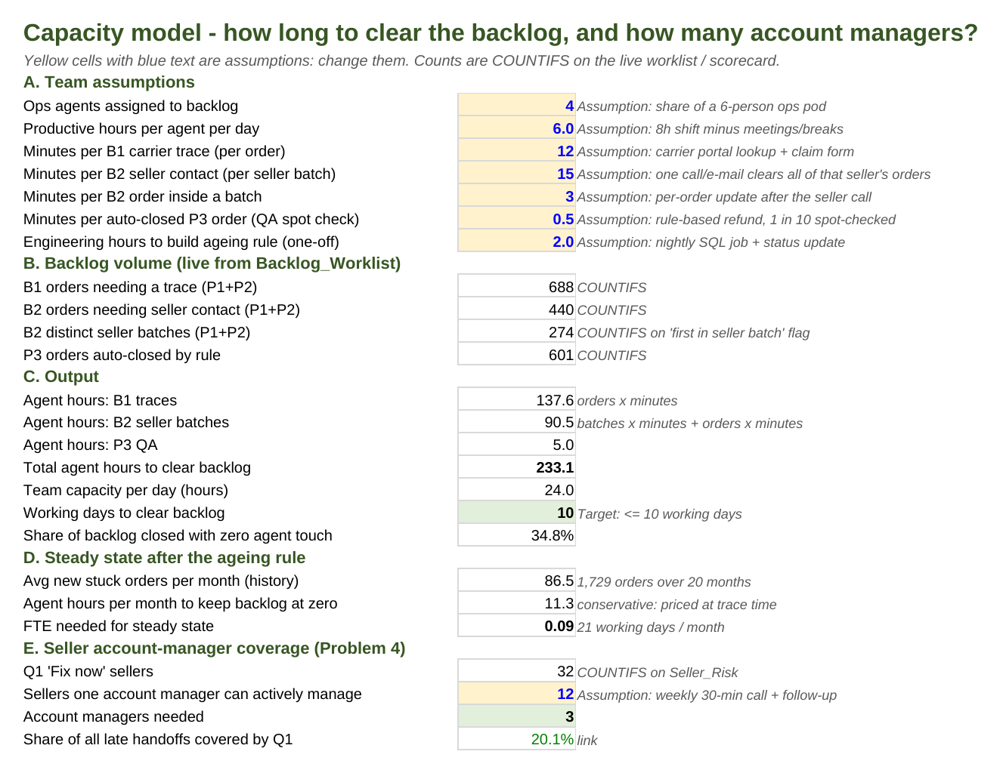

---

## Problem 3: Late Deliveries

**Tools:** SQL (`sql/03_delivery_kpis.sql`), notebook `notebooks/01_late_delivery_root_cause.ipynb`

Every order lifecycle was decomposed into distinct operational stages: payment approval, seller handling, and carrier transit. Haversine distances were derived from geocoded zip coordinates. Multivariable logistic regression and out-of-time Gradient Boosting were trained (training $\le$ March 2018, testing April–August 2018; LogReg AUC: 0.79, HistGB AUC: 0.77).

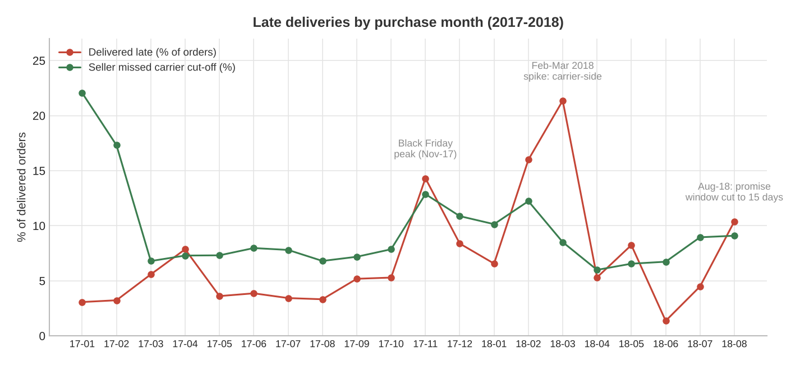

| Days per Stage | Review Score Distribution |
|---|---|
| 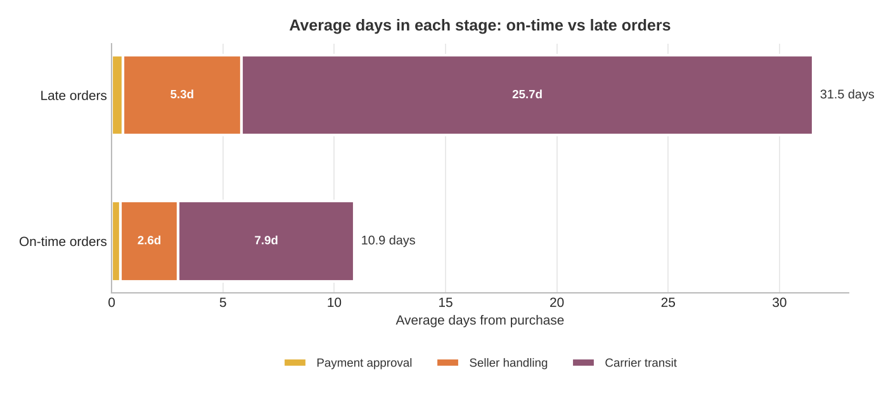 | 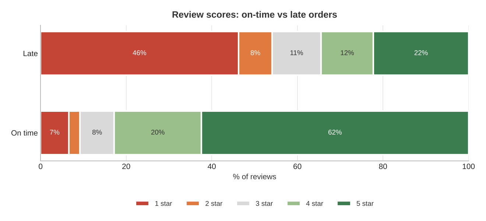 |

| Distance and Handoff | Logistic Odds Ratios |
|---|---|
| 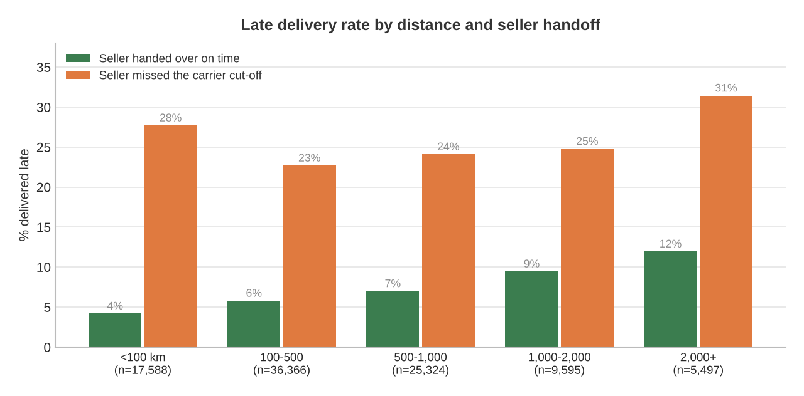 | 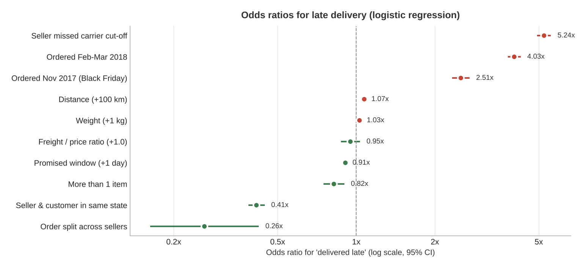 |

**Key Findings:**
- Overall late delivery rate is 8.2%. Late orders experience an extreme collapse in customer satisfaction: 54% receive 1-2 stars (vs. 9% for on-time orders).
- Missing the seller dispatch cut-off increases the odds of a late delivery by **5.0x**.
- **Crucial nuance:** Only 27% of late orders experienced late seller handoffs; 73% were handed over on time and were delayed in carrier transit (25.7 days vs. 7.9 days for on-time orders).
- Eradicating 100% of seller handoff delays only shifts overall lateness from 8.2% down to 6.6%. Long-tail carrier transit optimization is essential.

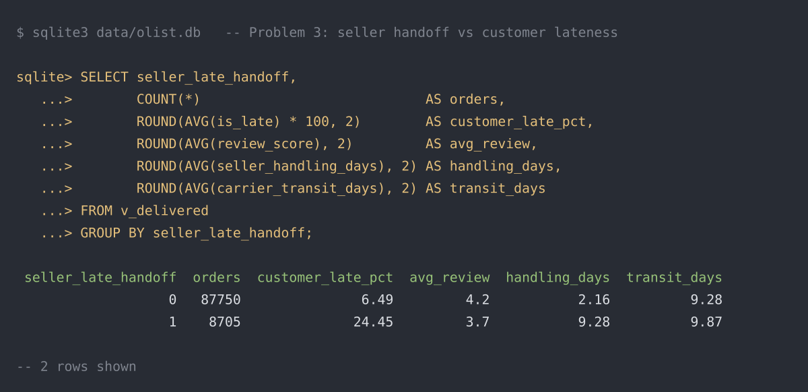

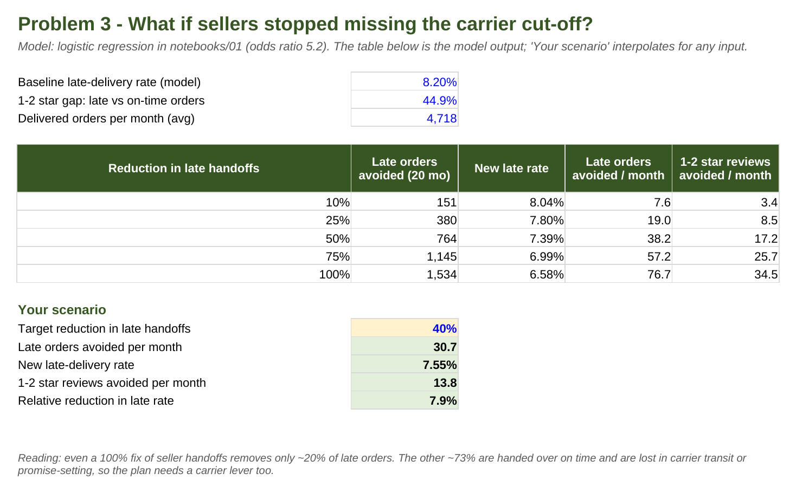

---

## Problem 4: Seller Risk Score

**Tools:** SQL (`sql/04_seller_scorecard.sql`), notebook `notebooks/03_seller_risk_scoring.ipynb`, Excel

To prevent small-sample noise (e.g., a seller with 1 late out of 3 orders appearing as 33% defective), metrics were smoothed using **Empirical Bayes shrinkage** towards the global platform prior. Sellers were segmented into four actionable quadrants across GMV and Risk.

| GMV Concentration | Strategic Priority Matrix |
|---|---|
| 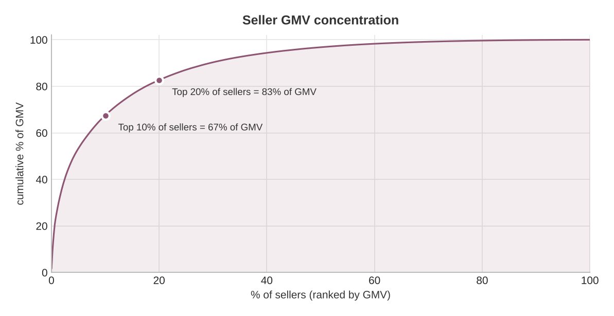 | 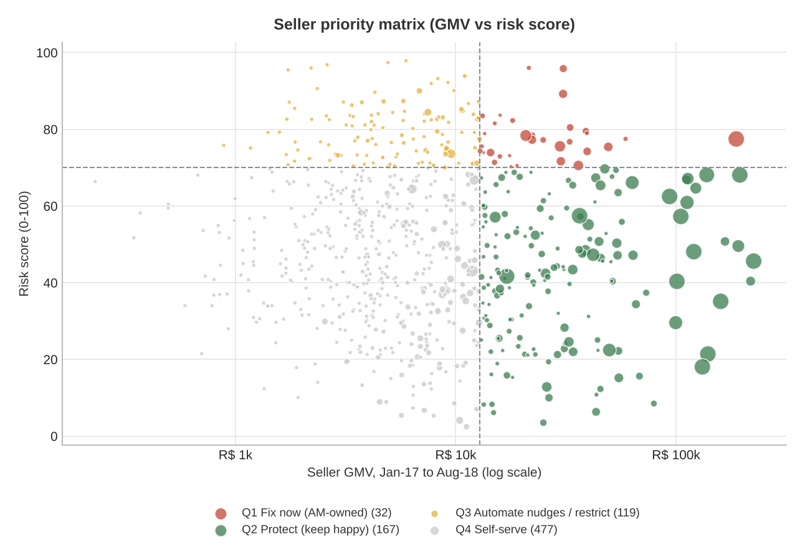 |

To guarantee real-world predictive validity, the risk score was fitted on pre-April 2018 records and evaluated out-of-time against April–August 2018 performance:

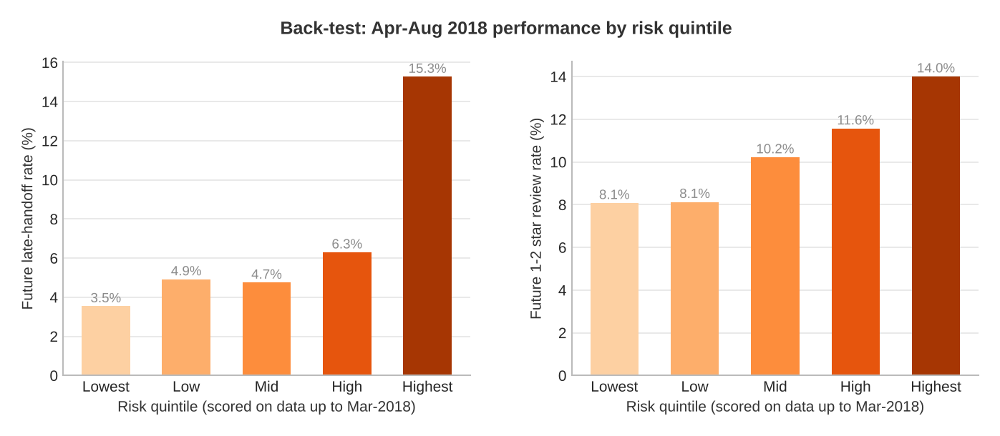

**Key Findings:**
- Extreme GMV concentration: Top 10% of sellers generate 67% of total platform GMV.
- **32 sellers in "Q1: Fix Now"** generate 20% of all platform late handoffs. Three account managers can cover them directly (~11 accounts each).
- Out-of-time validation proved the highest-risk decile experienced **4.3x higher defect rates** in future months compared to low-risk sellers.

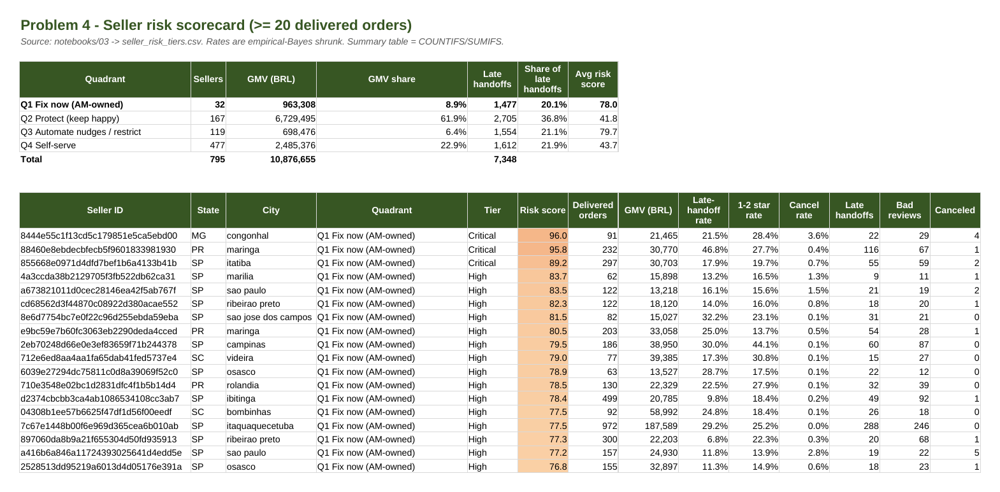

---

## Problem 5: Retention and RFM

**Tools:** SQL (`sql/05_customers_revenue.sql`), notebook `notebooks/04_customer_retention_rfm.ipynb`

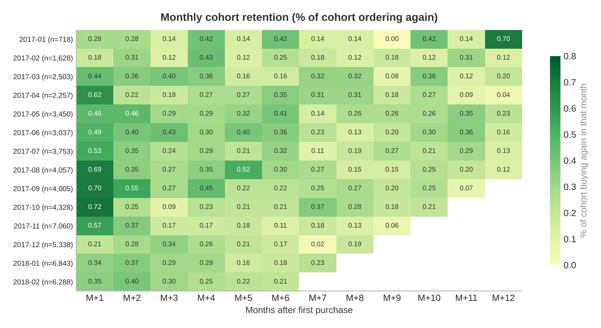

| RFM Segments | First Order Experience vs. Repeat |
|---|---|
| 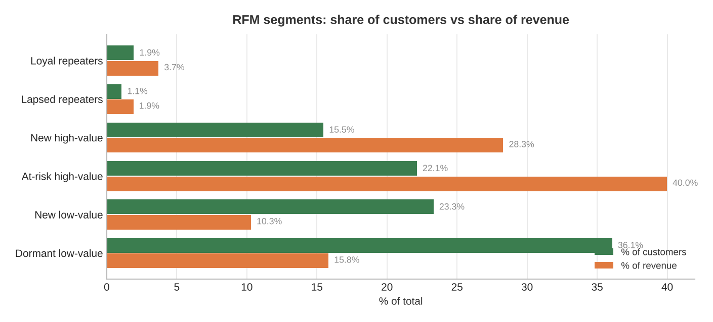 | 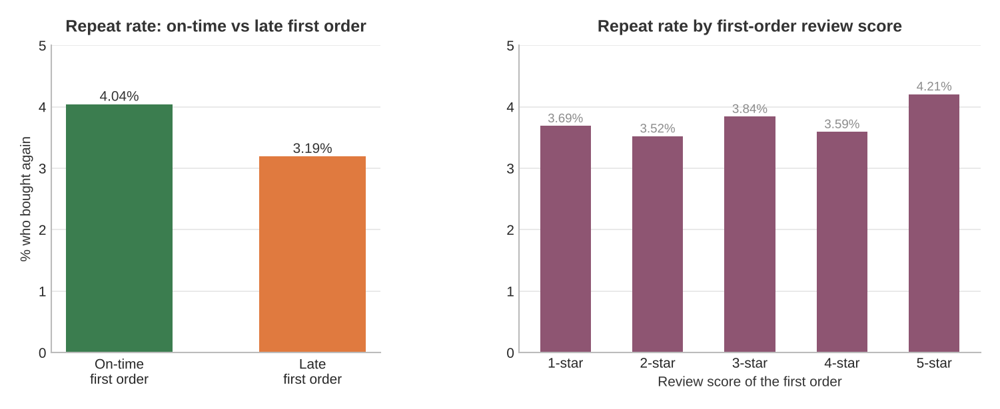 |

**Key Findings:**
- 97% of customers purchase only once; subsequent month repeat rates are under 1%.
- Standard RFM was adapted: since Frequency is largely binary, quintiles were built for Recency and Monetary spend, separating high-value one-time shoppers (who drive 68% of total revenue and represent prime win-back targets).
- **Statistical Rigor Check:** Customers with a late first order showed a lower raw repurchase rate (3.19% vs. 4.04%, $p = 0.007$). However, controlling for destination state, cohort month, and basket value via logistic regression showed the effect is **not statistically significant** (Odds Ratio: 0.87, $p = 0.13$). Operational delivery improvements must be justified through review preservation and refund reduction, not repeat purchasing.

---

## Excel Command Center

Located at `excel/Olist_Ops_Command_Center.xlsx`. Built without static hardcoded totals; all summaries and scenario models rely on native Excel dynamic formulas:

| Sheet | Purpose | Core Formulas / Architecture |
|---|---|---|
| **Cover** | Navigation, documentation, and color legend | Standardized corporate styling |
| **Dashboard** | Executive KPI tiles + interactive month selector | `INDEX/MATCH`, native charts, KPI formulas |
| **Monthly_KPIs** | SQL baseline + dynamic operations ratios | AOV, lost-order rate, MoM growth calculations |
| **Recon_Checks** | 9-check audit register with owners & controls | Preventative and detective control matrices |
| **Backlog_Worklist** | 1,729-order triage tracker with status dropdowns | Data validation, priority tags, conditional formatting |
| **Capacity_Model** | Live workforce planning tool (4 agents, 10-day clear) | Interactive yellow parameter cells, dynamic hours |
| **Seller_Risk** | 795 scored sellers with quadrant distribution | `COUNTIFS`, `SUMIFS`, `AVERAGEIFS` summaries |
| **WhatIf_Handoff** | Delivery SLA sensitivity calculator | Dynamic late rate reduction formulas |

> 💡 **Online & Local Usage:** Open the workbook directly in Microsoft Excel, LibreOffice, or upload it to Google Sheets (formulas and sheets transfer cleanly).

---

## Automated Testing & CI

A continuous integration workflow (`.github/workflows/ci.yml`) runs on all pushes and pull requests to maintain analytical rigor and prevent regression:

```bash
# Run the test suite locally
pytest tests/ -v
```

**Automated Test Coverage (`tests/`):**
- `test_sql_files.py`: Verifies all SQL queries exist and validates in-memory view compilation in SQLite against relational schemas.
- `test_processed_data.py`: Validates business assertions, 9-check reconciliation bounds, backlog counts (1,729 orders), bounded risk scores (0-100), and what-if monotonicity.
- `test_excel_deliverable.py`: Inspects workbook sheets, verifies openpyxl loadability, and verifies formula presence across dashboard and capacity sheets.

---

## How to Run

```bash
# 1. Clone repository
git clone https://github.com/moazzem-hossain-majumder/olist-marketplace-intelligence.git
cd olist-marketplace-intelligence

# 2. Install dependencies
pip install -r requirements.txt
pip install pytest sqlfluff

# 3. Run test suite
pytest tests/ -v

# 4. (Optional) Run the complete end-to-end data pipeline
python run_all.py
```

`run_all.py` executes the entire pipeline: downloads the public dataset, compiles the indexed SQLite warehouse, runs all analytical SQL scripts, executes notebooks, builds the Excel Command Center, and exports visual assets.

---

## Project Structure

```
olist-marketplace-intelligence/
├── .github/
│   └── workflows/ci.yml       GitHub Actions CI pipeline
├── .sqlfluff                  SQLFluff linter dialect & rule configuration
├── tests/                     Pytest suite (SQL, data assertions, Excel validation)
│   ├── test_sql_files.py
│   ├── test_processed_data.py
│   └── test_excel_deliverable.py
├── sql/                       Production SQL queries & analytical views
│   ├── 00_views.sql           Reusable modular views
│   ├── 01_reconciliation.sql  Problem 1: 9-check financial audit
│   ├── 02_stuck_orders.sql    Problem 2: Backlog triage engine
│   ├── 03_delivery_kpis.sql   Problem 3: Delivery SLA decomposition
│   ├── 04_seller_scorecard.sql Problem 4: Seller metric scorecard
│   └── 05_customers_revenue.sql Problem 5: Retention & cohort analysis
├── notebooks/                 Executed Jupyter notebooks with statistical models
│   ├── 01_late_delivery_root_cause.ipynb
│   ├── 02_reconciliation_and_backlog.ipynb
│   ├── 03_seller_risk_scoring.ipynb
│   └── 04_customer_retention_rfm.ipynb
├── scripts/                   Pipeline automation scripts & visual styling
│   ├── 01_download_data.py
│   ├── 02_build_database.py
│   ├── 03_run_sql.py
│   ├── 04_build_excel.py
│   ├── 05_sql_screenshots.py
│   ├── 06_excel_screenshots.py
│   ├── chart_style.py
│   └── make_demo_gif.py       Animated GIF generator
├── excel/
│   └── Olist_Ops_Command_Center.xlsx
├── data/
│   └── processed/             Exported CSV summaries & model outputs
├── images/                    High-resolution charts & animated demo GIF
├── reports/
│   └── executive_memo.md      3-page decision memo for leadership
├── requirements.txt
├── run_all.py                 Full pipeline orchestration script
├── CASE_STUDY.md              Comprehensive problem statement
└── README.md
```

---

## Limitations

- **Refund Transparency:** The public dataset lacks an explicit refunds/chargebacks ledger; unfulfilled orders with payments represent gross exposure at risk.
- **Geographic Approximation:** Seller-to-customer distance is estimated using zip-code centroids rather than route-mile street distances.
- **Data Truncation:** Deliveries in transit at the dataset export date (late August 2018) skew end-of-period statistics slightly optimistic.
- **Model Parameters:** Capacity model task durations (e.g., 12 min/trace, 15 min/call) are parameterized assumptions, marked in yellow in the Excel model for interactive tuning.
- **Observational Nature:** All regression estimates establish robust association and risk attribution rather than experimental causal proof.

---

## Author & Contact

**Moazzem Hossain Majumder**
- **LinkedIn:** [linkedin.com/in/moazzem-hossain-majumder](https://www.linkedin.com/in/moazzem-hossain-majumder)
- **GitHub:** [github.com/moazzem-hossain-majumder](https://github.com/moazzem-hossain-majumder)
- **Email:** [moazzemhossain1510@gmail.com](mailto:moazzemhossain1510@gmail.com)

Data: Olist Public Dataset under [CC BY-NC-SA 4.0](https://creativecommons.org/licenses/by-nc-sa/4.0/).
